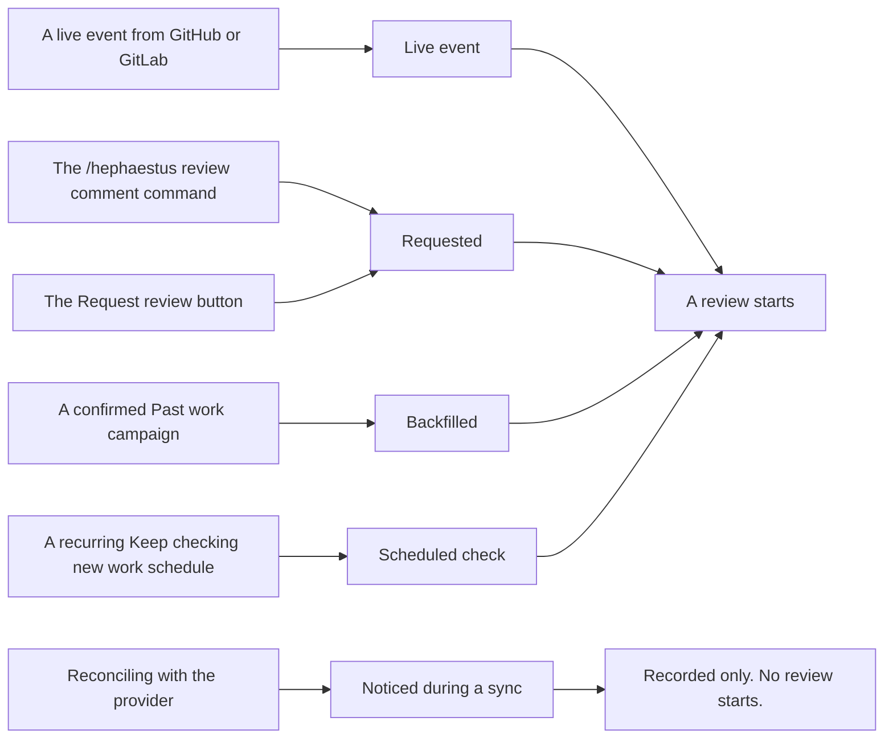

Practice review checks connected workspace work against its installed practices.
This work includes pull requests, merge requests, issues, documents, and settled Slack threads.
It first records grounded results.
It composes feedback only for pull or merge requests and issues.
Document and settled-thread reviews record their results and stop there.

A result is the verdict of one practice about one piece of work.
Its outcome is **Met**, **Not met**, **Does not apply**, or **Could not determine**.
A **Not met** result records one or more observations.
Each observation is one problem at a place in the work, with its own severity.
A **Could not determine** result names the open questions that the review could not settle.
A failure to capture evidence or to run the review is never a result about the work.

Feedback reaches the work, the developer's private practice pages, or a later mentor conversation.
This page explains setup, cost controls, and diagnosis of quiet workspaces.
Many review gates refuse work without a user-facing error.
Thus, a workspace can become quiet.
Every refusal has a record.

1. First, open **Practices → Practice reviews → Reviews** and set **Status** to **No review started**.
   It lists the work that Hephaestus recorded and that no review started on, each with the reason.

## First successful review

Use this path before changes to coverage, campaigns, or per-practice overrides.

1. Connect GitHub or GitLab.
2. Confirm that a recent pull or merge request appears under **Practices → Practice reviews → Reviews**.
   It can also appear under the status **No review started** on that tab.
3. If it does not, repair ingestion first.
   Practice-review settings cannot make missing work appear.
4. Under **AI models**, assign a ready model to practice reviews.
5. Open **Practices → Review settings → When and where**.
6. Turn on **Start practice reviews**.
7. Under **How reviews start**, enable **Start from work activity**, **Start requested reviews**, or both.
   The screen says *"Nothing can start a review"* if both are off.
8. Open **Practices → Review settings → How much**.
9. Keep **Workspace default** at **Review before sending**, its default.
10. Return to **When and where**.
11. Keep coverage at **All monitored repositories** and **All eligible linked members**.
12. Leave **Send feedback** on.
13. Open a small pull or merge request whose author is an eligible linked member.
14. Find that work under **Practices → Practice reviews → Reviews**, or under the status **No review started** if no review started.

The work distinguishes ingestion, admission, results, composition, withholding, and delivery.
A provider comment is not the success test.
After this path works, you can narrow coverage, add practice overrides, or configure past-work reviews.
The rest of this page gives reference information and diagnosis for those decisions.

### Follow one review end to end

Suppose a developer opens **Update dependencies** with no explanation in its description.
The review follows this sequence:

1. The provider event creates an occurrence.
   It appears under **Why it ran** on the sheet of the review.
   If no review starts, it appears under the status **No review started** on **Practices → Practice reviews → Reviews**.
2. Coverage admits the repository, base branch, and author before the review proceeds.
3. The review gate selects practices whose occasions match the pull request.
4. Capture satisfies each selected practice's evidence requirements before that practice runs.
5. A practice about why a change is needed can record a **Not met** result.
   Its observation is that the searched description has no explanation.
   That bounded result remains even if nobody receives feedback.
6. Composition considers the result with recent results and feedback.
   It can propose a public summary, private process feedback, mentor context, or no feedback.
7. Server-side policy admits or refuses each proposal.
   Feedback awaiting a decision appears first under **Needs you** on **Practices → Practice reviews**.
8. A workspace admin reads the exact in-context feedback and its results.
9. That person approves and sends the feedback, or rejects it.

A provider comment exists only after approval and a successful release-time policy check.
The smallest useful diagnostic sequence is occurrence → readiness → result → composition → delivery.

1. Stop at the first missing stage instead of random changes to downstream settings.

### Use the right screen

| Question                                                          | Open                                                        |
| ----------------------------------------------------------------- | ----------------------------------------------------------- |
| Did this piece of work enter the system, and why was it quiet?    | **Practices → Practice reviews → Reviews**, then the status **No review started** |
| What needs me, and are the reviews working?                       | **Practices → Practice reviews** (the overview)             |
| Did a job run, fail, or produce results and feedback?             | **Practices → Practice reviews → Reviews**, then open a row |
| Is in-context feedback waiting for approval?                      | **Practices → Practice reviews**, under **Needs you**       |
| How does one practice behave: its outcomes and incorrect marks?   | **Practices → Practice reviews**, then select the practice  |
| Which work may start reviews, and may feedback be sent?           | **Practices → Review settings → When and where**            |
| How far do reviews go without a person?                           | **Practices → Review settings → How much**                  |
| What does one practice review and which evidence does it require? | **Practices → Practice setup**                              |
| Who counts as a covered person?                                   | **Members**                                                 |
| Is the review model ready?                                        | **AI models**                                               |
| Did a budget stop new work?                                       | **AI usage**                                                |

### Read the Practice reviews overview

**Practices → Practice reviews** opens an overview.
Its time range is today, the last 7 days, 30 days, 90 days, or **All time**.
The default is the last 30 days.
**Today** starts at midnight in your time zone and compares with yesterday.

The overview keeps the range you chose while the browser tab is open.
When you come back from **Reviews**, **Results** or **Feedback**, it opens at that range again.
A link that names a range opens at that range.

**All time** counts every review since the first one in the workspace.
It has no period before it, so the tiles do not compare with one.
The lists that its counts open have no date range.
A link from before that asked for 12 months opens **All time**.

The range controls everything except two things.
What waits and runs in the queue is read now, and the queue says so.
Feedback awaiting approval remains regardless of its composition date.

The number beside **Practice reviews** in the sidebar counts feedback awaiting approval.
You can see it anywhere in the workspace.
If the **Practices** sidebar section is folded, the number appears on **Practices**.
If the sidebar shows only icons, the **Practices** tooltip gives the number.

**Needs you** counts the feedback awaiting approval and tells how long the oldest has waited.
**Review N pieces of feedback** opens the oldest in a queue.
This button is the only way into the queue from the overview.
The **Feedback** list shows every piece, if you want to choose one.
The panel shows your position, such as **2 of 7**.

The adjacent arrows move backward or forward through the queue.
Approval or rejection moves to the next piece or returns to a piece you skipped.
The panel closes when nothing else awaits a decision.

Feedback opened from the **Feedback** list, a review, or a result opens alone, without the queue.
If no feedback awaits your approval, one line states this.

Failures are counted where they happen, over the range, as rates:

- The **Reviews** tile gives the share of the reviews that finished that failed or timed out.
  An example is "9 % failed or timed out", the last item of its row of figures.
- The foot of the **By channel and reason** card gives the share of the feedback sent that failed to deliver.
  More than 5 % makes it red.
- The same foot gives the share of the reviews that completed whose results could not be processed or delivered.

The overview uses one colour rule: red means broken, and nothing else has a colour.
A figure is red when developers do not get their feedback and an admin can fix it now.
Only two figures can be red: **Feedback failed to deliver** above 5 %, and reviews on hold for budget.
The overview does not use amber.

The share of failed or timed-out reviews and **Reviews not processed or delivered** have no colour at any share.
An admin cannot repair a failed review from the overview.
A comment that could not be posted is already counted in **Feedback failed to deliver**.
Advice, such as a long wait or a practice marker, shows as words and an icon, without a colour.

The three rates never count the same thing twice in one unit.
A review that failed or timed out ended without results, so it counts only on the **Reviews** tile.
Only a review that completed can have results that were not processed or delivered.
**Feedback failed to deliver** counts pieces of feedback, not reviews.
A review whose comment could not be posted counts once as a review and once for each piece of feedback it held.

Each count opens exactly the corresponding list.

**Queue** follows, with one card in two parts.
Under **Now**, the card shows what waits and runs at this moment, whatever the range.
Under the name of the range, it shows how long the reviews of the range took and how many finished.
Each part has its own (i).

**What the reviews did** has a tile for **Reviews** and **Results**.
**Delivery** has the **Feedback** tile and the **By channel and reason** card.
Feedback awaiting approval is counted on the **Feedback** tile.
You approve it from **Needs you**.

**By channel and reason** splits the feedback of the range in two short tables, side by side on a wide screen:

- **Delivered by channel**: the delivered feedback by where it appeared.
  The words are those of the **Channel** filter of the **Feedback** list.
- **Withheld by reason**: the withheld feedback by who decided, in the groups and words of the **Why withheld** filter.
  Feedback that an admin rejected is a row of its own.

Each table gives its total in its heading, the same number as on the **Feedback** tile.
Each row is a link to the list filtered to exactly the rows it counts.

The foot of the card gives two failure figures over the range, each with its rate on the right.
**Feedback failed to deliver** is the share of the feedback sent that failed to deliver, in full or in part.
An example is "3 of 41 sent".
**Reviews not processed or delivered** is the share of the completed reviews whose results failed.
An example is "4 of 250 completed".

The count beside each label opens the list filtered to exactly the rows it counts.
The card shows counts only, never the text, rating or comment of a piece of feedback.

Each tile shows its total, change from the preceding period of equal length, volume through the range, and subdivisions.
Queued and running reviews have no result yet.
They come last in the row of figures as **not finished yet**, without a colour.
How many run and wait right now is on the **Queue** card.

Every tile has the same rows: the title, the total, the change, the chart, then the row of figures.
The charts of the tiles side by side are at the same height.

The tile titles are not links, because the tabs above open the same lists.
Each count on a tile opens its list filtered to exactly the rows it counts, over the range.
The **Results** tile names each outcome in its own words: met, not met, does not apply, could not determine.
Results marked incorrect are a correction, not an outcome, so they come last in the same row, without a colour.

Feedback groups are awaiting approval, prepared, delivered, unconfirmed, withheld, failed to deliver, and replaced by newer.
Delivered includes feedback that reached the developer only in part.
Unconfirmed is conversation feedback with no record that it appeared.
It is neither delivered nor withheld, and it is never prepared again.
Withheld includes feedback rejected by a reviewer.

Replaced by newer is not a loss: a later piece about the same work took its place.
It is counted apart and without a colour.
Each count opens exactly the rows it counts.

The **Feedback** tile counts withheld feedback.
The **By channel and reason** card says why.

The review time measures the reviews created in the range.
Its figure is the median of whole reviews: half took less, half took longer.
It starts at the moment on the work that started a review, or at its request if nothing started it.
It ends when the review posted its comment on the work.
Under the figure, one bar splits the same time into stages, with the words of the trace and the sheet of a review.
Each stage is as wide in the bar as its share of the reviews' combined time:

- **Until asked**: from the moment on the work that started the review until it was asked for.
  A review that a developer or an admin asked for waits nothing here.
  A review from a backfill or a sweep also waits nothing here.
- **Queue**: from the request until a worker picked the review up.
  For a review that was put back in the queue, the earlier attempt counts as waiting.
- **Preparation**: from when a worker picked the review up until its execution started, while it gathered the evidence.
- **Execution**: from the start of the execution until the review finished.
- **Run (not split)**: the whole run of the reviews that did not record when their execution started.
  Reviews from before that time was recorded are examples.
  The bar shows this stage only when the range has such reviews.
- **To developer**: from the end of the review until it posted its first comment on the work.

The legend apportions the whole-review median using these shares, so its numbers add up to the figure.
These are a proportional breakdown, not the median of each stage or the times of one actual review.
The trace of a review splits its run into **Preparation** and **Execution** in the same way when the review recorded when its execution started.
Otherwise, the trace shows one **Run**.

Only a comment that the review posted itself counts.
A comment that waited for the approval of an admin is not counted, because that wait is the time of a person.
Feedback on the practice pages of a developer and feedback in a conversation are not counted.
They become delivered when the developer opens the page or Heph shows them, and that is the time of the developer.

If no review in the range posted a comment on the work, the card says so.
It then gives the time from the request to the end of the review instead, over the reviews that completed.

The (i) beside the name of the range gives one short line for the figure and for each stage.
It also gives one line each for **Finished**, **Lost to merge** and **Finished after merge**.
The part of each stage is its time summed over the reviews of the figure, divided by their total time.

Some pieces of feedback can be withheld because the work was already merged when they were ready.
**Lost to merge** then says how many.
It counts pieces of feedback, not comments or reviews, and has no colour.

Some reviews complete after the merge of their pull request or merge request.
**Finished after merge** gives their number as a link.
A review that was cancelled, failed or timed out after the merge is not counted, because it posted nothing late.
The link opens the **Reviews** list with the **Finished after merge** filter, which shows the same reviews.
Some of them were started by the merge itself, so they could only finish after it.
The (i) says how many, for example "2 of them were started by the merge."

The card has two parts: **Now** on the left and the name of the range on the right.
On a narrow screen, the range goes under **Now**.
Each part gives its numbers in one line, each number before its label.

Under **Now**: **waiting**, **running**, **on hold for budget** and **oldest wait**.
**Oldest wait** is left out while nothing waits.
Under the name of the range, after the review time, the card gives **finished**.
It counts the reviews created in the range that completed, failed or timed out.
**Lost to merge** and **Finished after merge** follow when there are any.

**Waiting**, **Running** and **On hold for budget** open the **Reviews** list filtered to exactly the reviews they count.
**Waiting** opens the status **Waiting**, which leaves out the reviews on hold.
**Waiting** does not count a review that waits a short time before a retry, because no worker can pick it up yet.
The card does not list that review until then.

**Oldest wait** opens the review that has waited longest.
**Finished** opens the reviews it counts.
The (i) beside **Now** says what each figure counts and how many workers run reviews.
It also says how many reviews finish per hour now, over the last 24 hours.

The first three reviews in the queue are in a small table with the columns **Work**, **Developer**, **State** and **Since / Waited**.
**Since / Waited** is how long the review has run or waited.
For a review on hold for budget, the time counts from its request.
The work opens its review.

**See all** opens the **Reviews** list with the reviews the queue counts: waiting, running and on hold.
A review that backs off before a retry is not in that list.
A review on hold for budget is marked in red, because no review runs until an admin acts.
A wait of 30 minutes or more is marked with an icon and words, without a colour.

While a review waits or runs, the card reads the queue again every 10 seconds.
A review on hold for budget alone does not keep it reading, because nothing moves until the budget allows it.
It stops while the browser tab is hidden.
A wait counts from when the review became available to a worker, so a review put back in the queue waits from then.
When the last review finishes, the overview reads the time, the counts and the queue once more.

A review shows the same stages under **How it ran**, with the time of each stage that it reached.
It also gives the time until a developer read its feedback, apart from the stages.
If the work was merged before the review finished, the review gives the merge time and the interval.

**Practices** lists practices with a result, or feedback about one, in the range.
**Number of results** is the plain total of the results of the practice.
**Not met**, **Does not apply**, **Could not determine** and **Marked incorrect** each read as a part of that total, for example "19 of 89".
**Feedback delivered** reads as a part of the feedback composed about the practice, for example "7 of 12".
That total includes feedback that waits, was withheld or failed, so you can see how much of it reached the developer.
A piece replaced by a newer one is not counted, because the newer piece stands for it.

The last row, **All practices**, gives the totals of the range, the same figures as the tiles above.
It includes the practices that the filters hide, and a line under the table says how many.
The results of the practices add up to the totals, because each result is of one practice.
**Feedback delivered** can add up to a different number.
A piece of feedback about two practices counts in the row of each, and a piece about no practice counts in none.
The totals row counts each piece once, and a line under the table gives both numbers.

No cell shows a percentage.
The headings are short and centred over their numbers, and the (i) beside each heading says how its number is counted.
On a phone the headings are hidden, so one (i) under the table, **How the counts are reached**, says this for every column.
Every row has the same height.

Each row is one line: a long practice name is cut short, and the full name shows when you point at it.

By default, **Needs a look first** puts the practices with a marker at the top:

- **Never applies here**: 90 % or more of its results did not apply.
  The practice costs reviews and tells nobody anything, so consider turning it off for this workspace.
- **Often undecided**: 30 % or more of its results could not be determined.
  The review may lack the evidence to decide.

A practice needs 20 results in the range before it can get a marker.
Then come the practices with the most results marked incorrect, then the most that could not be determined.
The other practices follow busiest first.
**Sort** can order the whole table busiest first.
The choice stays in the address, so a reload or a shared link keeps it.

A practice that is turned off today does not show in the table.
Turned off means that the autonomy of the practice is **Off** in **Practice setup** now, or that the practice is no longer in the workspace.
The table reads this state when it loads, not the state when the results were recorded.
**Show turned-off practices** shows these practices again, and tells how many it hides.
**Group** limits the table to the practices of the selected groups.

Select a practice to open its sheet (see [Open a record](#open-a-record)).
The table is an overview, not a stream, so its rows have no **Track** or **Trace**.

The overview's lists are **Reviews**, **Results**, and **Feedback**.
The tabs share one scope: a developer, practice groups, practices, a date range, and a selection.
The scope stays when you change tabs.
Each list tab shows how many records it holds under the scope, for example **Reviews 1,688**.
The count follows the developer, group, practice, date range and selection, but not the filters of the tab itself.
A count shows when it is known, and the tabs never wait for it.

The overview has no count.
An overview count opens the corresponding list filtered to that range.

Each list applies the parts of the scope that its data supports:

| List | Developer | Group and practice | Date range | Selection |
| --- | --- | --- | --- | --- |
| **Reviews** | Reviews that recorded a result about the developer | Reviews that recorded a result about the practice | When the review was created (**Created**) | The selected review, the reviews of the selected work, or the review of the selected result |
| **Results** | The developer the result is about | Yes | When the result was recorded | The results of the selected work or review, or of the review of the selected result |
| **Feedback** | The developer the feedback is for | The practices covered by its results | When the feedback was composed | The feedback of the selected work or review, or the feedback written from the selected result |
| **No review started** (on **Reviews**) | No | No | When a moment was recorded | The selected work |

A review, a piece of work, or a result can also be a filter instead of the selection.
An older link to a list sets it.
The filter shows as a pill in the filter row, for example **Review: #1423 · 5 Oct, 2:02 pm**.
It narrows the lists as the selection does, but it does not show above the tabs and has no **Show trace**.
Only **Track** on a row makes the selection.

A part of the scope that a list cannot apply shows as **Not applied on this list**.
It applies again on the next tab that supports it.

A chosen group limits the **Practice** filter to the practices in that group.
The **Practice** filter also does not offer the practices that are turned off today.
**Show turned-off practices**, inside the filter, offers them again.
A practice that you already selected stays in the filter.

The developer, group, practice and date filters sit above the tabs, under **Applies to every tab**.
Below the tabs, each list shows all its own filters in one row that wraps, with the count on the right.
The applied filters show as pills below the row.

**Reset** clears the list's own filters.
**Clear scope** clears the shared scope.

**Reviews** filters by status and **Result processing**.
The status **On hold** lists the queued reviews that wait on a hold, such as the AI budget.
The status **No review started** lists the work instead of the reviews (see below).

The status **Waiting** lists the queued reviews that a worker can pick up now.
It leaves out the reviews on hold for the AI budget and the reviews that wait before a retry.
These are the reviews that the queue counts as **Waiting**.
With another status, **On hold** or **Waiting** adds its reviews to that status.

**Results** filters by outcome, **Developer response**, severity, and **Origin**.
**Feedback** filters by outcome, channel, and why it was withheld.
It can list the oldest first.

The **Reviews** list groups the reviews by day, newest first.
Each row shows the time and status, the reviewed work, and the developer.
A later review of the same work shows **Review 2 of 3**, and so on.
A chip beside the work shows only for a state that needs a look.

While a loaded review is queued or running, the list reads only the active reviews again every 5 seconds.
It reads all its rows again when a review starts or stops.

Each row in **Feedback** shows when it was composed, the channel, the work, the recipient, and the **Outcome**.
The row shows no text: the sheet of the feedback holds it.
The **Outcome** shows the icon and the label of what became of the feedback.
A withheld row adds why, in the words of the **Why withheld** filter, and the exact reason on hover.

Each row and each feedback panel shows where the feedback appears, for example "Comment on GitHub pull request #12".
**Channel** filters by that location: **On GitHub**, **On GitLab**, **With Heph in the app**, **With Heph in Slack**, or **On their practice pages**.
**On the work** and **In conversation** hold feedback with no known provider, such as feedback that no conversation has raised yet.

Select a **Developer**, or select the person on a row, to see a summary of all feedback for that person.
The summary counts their feedback by delivery and by channel.
Each count opens the matching feedback.

### Find work without a review

Set **Status** to **No review started** on the **Reviews** tab to list the work that no review started on.
This value does not combine with the other statuses: the value you select last applies.

Each row shows the latest moment on the work and how Hephaestus found out about it.
Select the row to open the sheet of the work.
The sheet tells why no review started.
If a setting stopped the review, a link in the sheet opens that setting.

On a pull request or an issue, **Request review** (play icon) at the end of the row asks for a review.
If the request starts nothing, the row tells you why.
A filter to one piece of work applies to this list too.
If the **Reviews** list has no review for the filtered work, **Show why no review started** opens this list.

An older link to the **Work** tab or to the former **Without a review** toggle opens this list.
An older link that opened a piece of work as a panel opens the sheet of the work.

### Open a record

Select a row to open the sheet of its record.
The sheet slides in from the right over the current list.
A sheet shows the permitted details of one record, and nothing about other records.
Every sheet has the same structure: a title, one status line, **What it is**, **State and history**, the details,
**Technical**, and the actions.
Each fact appears once, and every time is a date and a time.

- **Review**: its history from the request to the first posted comment, and where its time went.
  It also shows how it answered each practice, and its own delivery checks.
  **Technical** holds the model, the tokens, the retries and the exit code.
  These execution facts do not expose the retained runtime result or private feedback text.
  Its actions are **Cancel review**, **Retry result processing** and **Request another review**.
  **Request another review** asks you to confirm first, because the review runs as an agent job.
  It is disabled while another review of the same work is queued or running.
- **Result**: the outcome and severity, the practice, why it was raised, and all the evidence.
  It also shows each dispute in the developer's words, each correction and restore, and when it stopped being current.
  Its action is **Mark as incorrect** or **Restore result**.
- **Feedback**: the recipient and where it appears.
  Feedback on the work shows its first line as the title and its text as **Rendered** or **Source**.
  Feedback on a developer's Practice profile or in conversation shows delivery metadata, never its private text.
  It also shows who approved or rejected it, and why it was withheld.
  The status line gives its outcome, such as **Failed to deliver**, once.
  **State and history** tells what became of each delivery to the provider, such as **Stopped trying**.
  It adds the attempts and the last error.
  It links to each posted comment and lists every withdrawal.
  The decision on a proposal is in the footer. Its actions are approve, reject, withdraw and restore.
- **Work**: the work on its provider, every moment recorded on it, when it was merged, and why no review started.
  The sheet can say that the workspace does not monitor the repository, or that the provider deleted the work.
  Then it shows the server's answer under it.
  Its action is **Request review**.
  It asks you to confirm first, and it is disabled while a review of the work is queued or running.
- **Practice**: its full definition, as **Practice setup** shows it, with a link to its form there.

A sheet links only to the provider of the work and to the settings that an action needs.
One exception: the sheet of a replaced review links to the newer review that replaced it, because that review holds its practices.
It does not link to other records: the trace of the record shows how it relates to other records.

There is never more than one sheet over a list.
Escape closes the sheet, and the focus returns to the row that opened it.
The page address identifies the open sheet, so you can share it.
An older link that opened a review, a piece of work or a practice as a panel opens its sheet.

### Track and trace a record

Each row in **Reviews**, **Results** and **Feedback** has two buttons in its **Actions** column.
A row in **Reviews** has a third button, **Request review**.
The (i) in the **Actions** header says what each button does.
No button opens the row, and a click anywhere in the **Actions** column does not open it either.

- **Track** (crosshair) makes the record the selection.
  Every list narrows to the records related to it.
  These are the reviews, results and feedback of the same review, work or practice.
  The row of the tracked record is highlighted.
  Above the lists, the selection shows, for example "Tracking: Review of #1423 · 5 October, 2:02 pm".
  It shows on every tab, and the URL holds it, so you can share the link.
  The overview does not apply it.
  Select **Track** again, or the clear button on the selection, to stop tracking.
- **Trace** opens the trace of the record and also tracks the record.
  **Show trace** on the selection opens the same trace.
- **Request review** (play icon, **Reviews** only) asks for a new review of the work of the row.
  It is the same request as **Request another review** on the sheet of the review.
  It asks you to confirm first, because the review runs as an agent job.
  While the confirmation is open, the page behind it does not respond.
  Escape or **Cancel** closes it, and the focus returns to the button.
  The job counts toward the AI usage of the workspace.
  The button is disabled while a review of the same work is queued or running.
  It is also disabled for work that nobody can request a review for, such as a conversation.
  Its tooltip tells you why.
  When the review starts, a message confirms it and the list reloads.

Each row in **Reviews** shows when the review was created (**Created**), the work and the developer.
Beside the work, a chip marks a state that needs a look.
The chips are **On hold**, **Failed**, **Timed out**, **Replaced by newer**, **Result processing failed**, and **Finished after the merge**.
A review with none of these states has no chip.
What the review found, practice by practice, the feedback and what started the review are on the sheet of the review.
To see the feedback of a review, track the review and open **Feedback**.

The trace is a sheet over the list, as wide as every other sheet.
It tells the story of the record from top to bottom in the order that things happened:

1. A sentence on top tells what became of the record.
   A review that assessed nothing says so.
   Its evidence could not be read, or an earlier review on the same code had answered every practice.
2. A box under the sentence tells where the path stopped or slowed, and why.
   It names the first thing that stopped the path.
   This can be a review that failed, timed out or was canceled, with its error or reason.
   It can be an admin's hold, or feedback that was withheld, with the reason.
   Feedback withheld because the work was already merged also tells when the merge happened.
   The merge can come before the review was asked for, in the queue, or while the review ran.
   It can also come after the review finished, before its comments were ready.
   If nothing was lost, the box tells what the path waits on.
   Examples are an admin's approval, a conversation, or a card that nobody opened yet.
   Otherwise it names the longest wait of 30 minutes or more, or tells that there was no bottleneck.
   The box has the colour of what the loss asks of you, as the overview splits withheld feedback.
   A failed delivery is red.
   Feedback lost to timing is amber, because the work moved on before the comment was ready.
   Feedback the review, the developer or an admin held back is grey, because nothing went wrong.
   "No bottleneck" is a grey line without a box.
   Under the box, a strip shows where the time went, stage by stage.
   The strip shows the wait until the review was asked for, the queue, and the run.
   When the review recorded when its execution started, the run is split into **Preparation** and **Execution**.
   It also shows the time until the feedback reached the developer and until a developer first read it.
   A wait of 30 minutes or more is coloured.
3. Each stage has a header with its own icon.
   The stages are **Trigger**, **Review**, **Feedback** and **Effect**.
   The **Review** header shows the queue and run times.
   The **Feedback** header shows how many pieces reached the developer.
   A mark such as **Lost here** or **Time went here** shows the stage where the path stopped or slowed.
4. **Trigger**: the work and the moment that started the review.
   Moments before the review fold into one line.
5. **Review**: its status and why it ran.
   If the work had more than one review, it shows which review this is.
   An example is **Review 3 of 7 on this work**.
   With **System info**, also its model.
   The results of the review show as a count by verdict and a numbered dot for each result.
   **Show all results in the table** opens a table with one row for each result.
   The columns are the number, the practice, the outcome, the severity, the feedback written from it, and the time.
   **Fold the table** closes it again.
   The table opens and closes on its own button, so you do not need **Siblings** for it.
6. **Feedback**: a table with one row for each piece of feedback, in the order that they were written.
   The columns are the letter, the channel, the state, the results it was written from, and the time.
   The channel is on the work, on their practice pages, or in conversation.
   The state tells where the piece went or why it was withheld, and whether the developer answered.
   **From** shows the numbers of the results, as the result table shows them.
   A moment on the work between two pieces, such as the merge, starts a new table at its time.
   A card on their practice pages that no developer opened yet says **Not opened yet**.
7. **Effect**: whether the developer answered or disputes it, and whether their work resolved it.
   The end of the path tells if it worked, did not arrive, or is still open.

The trace shows a current dispute with the reason the developer wrote to the admins.
It shows a recorded current answer and its date, but never a rating given alone.
It does not show how they rated the feedback, what else they decided, or any note beside it.
These stay private to the developer.

The record that you opened the trace for is marked **You started here** and has a ring.
The trace shows the path of the record and folds the other records of the review into one line.
**Steps** limits the trace to the feedback, to what was lost, or to one practice.
**Show** has four toggles.
Each toggle applies to the whole trace:

- **Times** shows the time of each step and the time since the step before.
  A wait of 30 minutes or more is coloured, and the line to that step is dashed.
- **System info** shows the state and the model.
  It also shows each fact of a piece of feedback, and the facts under the record that you started from.
- **Siblings** lists the other results and feedback of the record that you started from.
- **Connections** draws a line from each result row to the feedback written from it.
  The **From** and **Feedback** columns tell the same relation in words, so this toggle is off at first.

**Times** is on at first, and the other toggles are off.
Your browser keeps your choice for the next trace that you open.
**Expand all** opens each folded part: the moments before the review, the result table, the other records, and the facts.
The facts under a step tell only what its own line does not:

- The work: a link to it, the number of moments, and when it was merged.
- The review: when it was asked for, picked up and finished, its attempts, its model, and how far it got.
- A result: what became of it, the day it was recorded, and when an admin marked it incorrect.
- A piece of feedback: where exactly it went, what became of it, and each dated step.
  Each step shows the time since the step before.
  With only **System info**, it also shows the practices that the piece was written from.

A moment, the count of results and the end of the path have no facts of their own, so they open nothing.
**Collapse all** folds them again.

**Legend** shows each mark of the trace with its name and one line of meaning.
Each mark looks the same as in the trace.
The legend puts the marks in groups.
The first groups are the stages and their marks, the dots of the steps, and the ends of a path.
The other groups are the result chips and feedback letters, the connections, the rail, and the icons.
Under the groups, the legend explains some terms and tells what the trace cannot show.

Select a step or a table row to open the sheet of its record over the trace.
The sheet covers the trace to the same depth as a panel over another panel on the Practice profile.
A strip of the trace stays in view at its left.
The record is the result, the piece of feedback, the review, or the work.
Each record opens from one step only.
A moment, the count of results, and the end of the path open no sheet.

On a narrow screen, each table row shows its cells on stacked lines.
This sheet is the same sheet as from the row, so it has no links to other records.
The mark **You started here** stays on the record that you opened the trace for.

Escape closes the sheet and returns to the trace.
A second Escape closes the trace.

For work that no review started on, the trace shows the latest moment and why no review started.
An older link to the page of a review opens **Reviews** with the trace of that review.
If the link pointed to one result or piece of feedback, it opens the trace of that record.

### Do not grade with standings

A standing comes from AI review of the work, and it can be wrong.
Do not use standings, results, feedback, or the counts on Practices across the workspace to grade or assess a person.
A person must assess the work.
If a result is wrong, correct it.

### Correct a result that was wrong

1. Open the result under **Practices → Practice reviews → Results**.
2. Select **Mark as incorrect** at the bottom of the panel.
3. Supply a reason that the developer will read.

The review record stays unchanged.
The result no longer contributes to the developer's standing, Practice profile, or Heph's context.
Feedback about it that has reached nobody is withheld.
If Hephaestus is delivering feedback that cites it at that moment, it asks you to retry and changes nothing.

Comments already on the pull request or merge request do not change immediately.
The page shows their resulting state, and each state has a record.
The table contains the exact UI text:

| State                  | Sentence shown while the correction is in force                                                                                                                                                                                                                                                                      |
| ---------------------- | -------------------------------------------------------------------------------------------------------------------------------------------------------------------------------------------------------------------------------------------------------------------------------------------------------------------- |
| Pending                | `Hephaestus is still correcting the comments it posted about this result, or it is still checking whether a comment it tried to post arrived.`                                                                                                                                                                       |
| Nothing posted         | `No comment about it was found on the work.`                                                                                                                                                                                                                                                                         |
| Updated                | `Every summary comment Hephaestus posted about it now opens with a correction notice, or has since been deleted.`                                                                                                                                                                                                    |
| Inline comments remain | `Comments Hephaestus posted about specific lines, whether on the lines or linking to them, are still on the work unchanged, because they cannot be edited from here. Any summary comment now carries a correction notice. Remove or answer those comments on the pull request or merge request.`                     |
| Unresolved             | `Hephaestus cannot correct every comment about it. A summary comment could not be edited, the provider did not say which comment it accepted, or a posted comment is unconfirmed. Check the pull request or merge request and correct it there. Hephaestus keeps checking and updates this if it finds the comment.` |

**Restore result** reverses the correction with a second reason.
It removes any notice the correction added and resends nothing.
Every correction stays listed on the page.

### Withdraw feedback whose words were wrong

Results can be correct while their feedback is incorrect.
Only a developer's Practice profile card that awaits display or has appeared can be withdrawn.
You cannot recall feedback posted on the work or raised in a conversation here.

1. Open the feedback under **Practices → Practice reviews → Feedback**.
2. Select **Withdraw feedback** at the bottom of the panel.
3. Supply a reason.

Withdrawal has these effects:

- The feedback's text, delivery, and results stay unchanged.
- A card that the developer had not seen never appears.
- A previously seen card temporarily shows a withdrawal notice without your reason.
- Later reviews and Heph receive the record that the card existed, without its text.
- Context already given to a review or used in a conversation is not recalled.
- A card on display at the withdrawal moment might already have reached the developer.

**Restore feedback** reverses withdrawal with a second reason.
The card returns through its ordinary checks.
Nothing is sent again.
Every withdrawal and restoration stays listed.
A new withdrawal after restoration adds a new entry.

### Act on a dispute

Developers dispute feedback from their own reviews, linked by every comment on the work.
They can also select **Disagree** on a Practice profile card.
The dispute appears on each result that the feedback used, with the developer's explanation.
It adds a **Disputed** mark in the **Results** list and the **Developer response** filter.
The explanation appears at the top of the result and feedback panels.
It is the developer's explanation addressed to you.

Practice profile and conversation feedback text remain hidden from you.

1. Decide what the dispute concerns.
2. If the result was incorrect, use **Mark as incorrect**.
3. If the results were correct but the Practice profile card was incorrect, use **Withdraw feedback**.
4. If neither applies, leave the dispute unchanged.

The dispute stays on the result until the developer withdraws it.
While it stands, later reviews of the same work do not raise the same point about the same place again.
The withheld feedback lists that reason.
A different point, or the same point on other work, is not withheld.

Nothing already posted on the work or said in conversation is recalled.
A summary comment gets a correction notice where the provider permits an edit.
Inline comments and conversation replies stay unchanged.

### Approve or reject feedback

Feedback on the work awaits approval by default.

1. Open it under **Needs you**.
2. Check the exact proposed summary and inline comments against their results and observations.
3. Select **Approve and close** to approve that package and close the panel.

Approval still passes current delivery checks.
It does not approve a pull request for merge.
**Reject feedback** requires one reason:

- **Incorrect**.
- **Missing important context**.
- **Not useful to the recipient**.
- **Already covered elsewhere**.
- **Wrong place for this feedback**.
- **Something else**.

1. Add the requested explanation.

The decision records your identity and reason.
Rejection does not mark results incorrect.
Use **Mark as incorrect** for that.

## What starts a review

Five entry paths start reviews.
Provider reconciliation also records an occurrence, but stops before a review starts.

The labels on the right match the moments under **Why it ran** on the sheet of a review and under the status **No review started**.
Two distinctions matter:

- **The comment command and button have indistinguishable records.**
  Both record `Requested`.
  The data does not identify which one was used.
- **Provider reconciliation records an occurrence but starts no review.**
  For pull requests and issues, a sync establishes that something happened, not when.
  A later review would spend money on a stale event.
  Settled Slack threads are the exception.
  Their thread sweep records the occurrence and starts the review.

All five entry paths spend from the workspace's AI budget.

| Entry path                                                 | Who may use it                                                                 | Rate limit                                                 |
| ---------------------------------------------------------- | ------------------------------------------------------------------------------ | ---------------------------------------------------------- |
| Live event                                                 | Nobody. It is automatic, per the practices' occasions                          | Per-workspace cooldown between reviews of the same work    |
| `/hephaestus review` in a **GitLab merge request** comment | The work's author or assignees, or a workspace admin                           | Per-person hourly allowance and the same per-work cooldown |
| **Request review** in the app                              | The same people. Only authorized readers see it, and the server refuses others | Per-person hourly allowance and the same per-work cooldown |
| **Past work** campaign                                     | A workspace admin, only after confirmation of a priced estimate                | The campaign's own scope                                   |
| **Keep checking new work** schedule                        | A workspace admin                                                              | One campaign at a time per workspace                       |

Two switches control the whole table.
**Start from work activity** controls the first row.
**Start requested reviews** controls the other four.
If it is off, the button, comment command, campaigns, and schedules all stop.

Every entry path passes coverage checks.
A manual request does not broaden coverage.
A request about an uncovered author is refused, as a live event would be.
The button appears only on pull requests and issues in these places:

- A developer's **Activity**, beside their own open pull requests and assigned issues.
- Their **Reviews of your work**, beside work with recorded review results.
- For workspace admins, any pull or merge request or issue under **No review started** on the **Reviews** tab.

Documents and Slack threads use their source's occasion, without a manual review target.
There is no comment command on GitHub pull requests.

## Deployment

The workspace setup above is not sufficient on its own.
The deployment must enable the agent runtime on both the submitting server and claiming worker.
It must enable repository checkout wherever evidence capture runs.
Until then, every workspace on the instance stays quiet, regardless of configuration.

No instance population flag configures workspace coverage.
Instance silent mode is the separate emergency brake for external delivery.
[Practice review operations](./practice-review-operations.mdx) covers variables, Compose forwarding, storage, queue metrics, retention, and fixed limits.

Review conditions belong to each practice, not workspace coverage.

1. In the practice editor, select permitted states, such as pull/merge-request draft status or document archive status.

Selection of every value leaves that condition unrestricted.

## Autonomy, coverage, and delivery

Three independent controls answer different questions.
Confusion between them is the most common misconfiguration.

- **Who authorizes release** uses **Off**, **Review before sending**, or **Send automatically**.
  **Off** stops the review.
  The Practice profile and Practices across the workspace then show nothing for the practice: no standing, no feedback card.
  The admin views still show its results and feedback.
  **Review before sending** continues measurement.
  It queues each new in-context piece of feedback for a workspace admin to approve or reject.
  The developer's practice pages and mentor still receive feedback on request.
  Only the developer reads those channels.
  **Send automatically** permits new feedback on the work without that decision, subject to the same delivery policy.
  A setting change never releases an existing proposal.
- **Coverage**, under **What gets reviewed**, selects all or selected monitored repositories and people for repository work.
  An empty repository selection covers no repository work.
  Slack conversations and Outline documents have no repository.
  They follow the people selection and their own collection permissions.
  An empty people selection covers nobody across every work kind.
  People coverage uses linked human workspace membership.
  See [Who counts as a person](#who-counts-as-a-person).
- **Send feedback**, under **Sending feedback**, controls whether feedback can leave Hephaestus.
  It stops comments on connected work and feedback in the mentor.
  It does not stop measurement, discard configuration, or remove the developer's own feedback pages.
  Those pages are not external delivery.
  Pause is the immediate workspace brake.
  Feedback approved but unsent at pause is permanently withheld, as automatic feedback is.
  Resume cannot release that old work.
  Undecided proposals stay in the approval queue.
  After resume, a workspace admin can still inspect and decide each proposal under current policy.

1. To stop all new practice reviews, turn **Start practice reviews** off.

Changes to coverage, **Post feedback after merge**, or workspace default autonomy invalidate admitted, unsent automatic feedback.
This applies to narrower and broader settings.
That feedback never re-enters delivery.
A later review creates new feedback.
Undecided proposals remain explicit workflow items and pass current policy checks on later approval.

A cooldown change does not advance the revision.
Delivery checks group and practice overrides separately.
Those overrides never promote an existing proposal to automatic delivery.

### Who counts as a person

People coverage contains linked human workspace members.
The **People** count on the review screen shows how many are in scope.
Only the member's account on the connected GitHub or GitLab instance counts.
The GitHub profile of a GitLab workspace creator establishes membership, not a reviewed person there.
A covered person must appear as eligible on **Members**.

1. Manage a missing person in the connected organization, group, or team roster.
2. Let membership sync add them.

Sign-in to Hephaestus alone does not create workspace membership.
GitLab workspace members include everyone with group access shown in GitLab's group member list with **Include inherited** on:

- Direct group members.
- Parent-group members, including students in a course's parent group for a workspace on its subgroup.
- Members of an invited group, limited to the invitation's role.
- Subgroup members, such as tutors listed only in a team subgroup.
- Project members with Developer or Reporter roles in the group or its subgroups, including a student on one project only.

If GitLab lists someone repeatedly, their highest role applies.
Maintainer and Owner roles make workspace admins.
Someone listed only by a subgroup or project is a member.
An email invitation counts after acceptance.
The workspace owner retains the workspace regardless of the roster.

A person leaves when GitLab stops listing them.
Removal is immediate if GitLab reports loss of access to the group and every subgroup.
Otherwise, removal occurs at the next membership sync (`MONITORING_SYNC_CRON`) with a complete GitLab listing.
An incomplete listing changes nobody.
Removal of direct membership does not remove a person with access through a parent or invited group.

The person a practice evaluates must be covered.
Usually this is the pull-request or issue author.
Reviewer practices use the reviewer.
Outside contributors, unlinked reviewers, unidentified people, and bots remain outside coverage.
Hephaestus prepares no feedback about them.

1. Before a diagnosis of broken reviews, read the **People** count.

If it is below your contributor count, the difference is nonmembers.

### You set this once, not a hundred times

The workspace's **Autonomy** answer applies to every group and practice until an override.
A group can override the workspace.
A practice can override its group:

> practice → its group → the workspace

An undecided value shows as **inherited**, with its source level.
You can reset an override to inheritance at any time.
Workspaces can have dozens of practices across a dozen groups.
A setting that needs individual row changes is unlikely to be applied.

1. Start with one workspace answer.
2. Override the few groups where that answer is inappropriate.

Coverage does not use inheritance.
It is set once for the whole workspace on **When and where**.
Above its list, **Review settings → How much** counts practices at each setting for the workspace and each group.
That line is the fastest way to check an old override.
**Set by hand** filters the list to overrides.

1. Before a change, read that count line.

The [practice review glossary](/contributor/practice-review-glossary) defines exact refusal semantics and delivery-gate order for all three controls.

## What costs money

A review can make many model calls.
These controls limit admission and spend:

- **The monthly AI budget** has two separate caps, which are never added together.
  The *instance* budget caps shared-model spend for models you registered.
  The *workspace's own* budget caps its connected-provider spend.
  Each pauses only the work it funds.
  Exactly `0` stops that budget's spend mid-month.
  An empty field removes the cap.
- **The cooldown** is the minimum gap between reviews of the same work for the same occasion.
  New commits become eligible for one review at the latest commit after ten quiet minutes.
  They also become eligible sixty minutes after the first pending push.
  The cooldown can delay that review further.
  This groups changes and is not an hourly rate cap.
  Queue and concurrency limits also affect review start time.
- **The per-person hourly allowance** limits hand-requested reviews.
- **Coverage and autonomy** determine eligible work.

A budget pause is a **hold**, not cancellation.
Queued jobs resume automatically after a cap increase or a new month.
A job still over cap seven days after queue entry is canceled instead of held forever.

**Practice reviews go silent when a budget is exhausted, and the mentor does not.**
A queued review is refused before execution and posts nothing.
No end user sees an error.
A mentor request to an exhausted budget receives a reply that names the cap and who can raise it.
Operators hear about mentor failures but must actively inspect review failures.

[Integrations & Reference Deployment](./production-setup#instance-wide-llm-settings) explains full budget mechanics, including an unverifiable month.

## Reviewing past work

A campaign is a bounded decision.
A recurring check is ongoing authorization.
**Past work** is under **Administration → Practices → Review settings → Past work**.
The recurring check is on **When and where**, beside other review triggers.

**A campaign — *Past work*.** A campaign is bounded, priced, named, and ends.
No review starts until confirmation.

1. Choose a kind of work and a lookback window.
2. Select **Estimate this backfill**.
3. Review the work count and estimated cost.
4. Confirm the campaign.

:::caution CAUTION: A recurring check authorizes spending *and* speaking
A schedule starts every campaign **directly in a running state** under its creator's authority.
Each run has a cost estimate, but nobody approves it.
There is no sweep-specific cap.
Only the workspace AI budget, schedule scope, or a disabled schedule stops it.
Before confirmation, the screen states:

> Every check can start reviews, so this authorizes the AI spend for all of them, not just the first.

**A swept review is a normal review.**
It records live results, composes feedback, and delivers provider comments, practice-page cards, and mentor context.
It behaves as an event-triggered review would.
The sweep finds current work that had no notification.
A schedule is an ongoing decision about spend and feedback, not a one-time action.

1. To stop it, select **Pause** or **Remove** on the schedule, or cancel its campaign.

Windows intentionally overlap so previously missed work gets another opportunity.
Previously reviewed work does not incur a second review charge.
:::

**A schedule — *Keep checking new work*.** The schedule reviews work that raised no notification and would otherwise silently remain unreviewed.

1. Choose a kind of work.
2. Choose a cadence.
3. Choose how far back each check reaches.

**A campaign, by contrast, is measured and never delivered.**
Backfilled runs never enter composition.
The in-app channel also refuses a pattern supported only by backfilled results.
Results appear in read models and under **Practices → Practice reviews**.
They never become comments, practice-page cards, or mentor briefs.

This behavior cannot be changed by a setting.
A campaign changes what you can read about past work.
It does not contact the people whose work it measured.
A campaign does not move a practice's trend.
It does not resolve feedback on the Practice profile.
If only a campaign judged a practice, that practice shows a standing from the campaign alone.

## When a workspace goes quiet

Step 0 usually ends diagnosis.
Steps 1–7 are workspace-specific.
Steps 8–10 apply to the instance.
If several workspaces became quiet simultaneously, start with steps 8–10.

**0. Open the work.**

1. Open **Practices → Practice reviews → Reviews**.
2. If the work has a review, open the sheet of the review.
   Otherwise, set **Status** to **No review started** and open the sheet of the work.

Names follow the provider, such as *Pull request #1423* on GitHub or *Merge request !1423* on GitLab.
The sheet of a work under **No review started** counts the recorded moments and shows the latest one with the reason for no start.
The sheet of a review includes:

- **Why it ran**: records, discovery method, review start, and any reason for no start.
- **Every practice**: each practice's result and a sentence that states what would change it.
- The number of results and feedback. **Trace** on the row shows each of them.

A quiet workspace with rows differs from a quiet workspace with none.
The sentences give the same reasons as the checks below.
They identify the relevant next step.

1. If the work reports an unset model, disabled practices, or an exhausted budget, repair that configuration.
2. If it reports no records, check the integration's sync.

The latter problem is upstream of practice review.
If the work is not visible on the provider, a sync marked it as gone.
This is not misconfiguration.
Reviews remain held until a sync finds the work again.
They run automatically after its return, or are dropped if it stays absent for a week.

1. **Check the review model assignment and its enabled state.**
   Open Administration → **AI models**, the **Practice reviews** card.
2. **Check whether the assigned model remains usable.**
   The model and connection must be enabled, and the protocol must be supported.
   A shared model for selected workspaces also requires this workspace's grant.
   Grant revocation or connection disablement stops every workspace with an assignment to the model, although the assignment still appears correct.
3. **Check for an exhausted budget.**
   Administration → **AI usage** identifies the budget and who can raise it.
   `agent.queue.held` counts capped jobs.
   `agent.queue.depth` counts only jobs a worker can claim now.
   Use held jobs for alerts, not depth.
4. **Check whether practice review or the workspace is off.**
   **Start practice reviews** is under Administration → Practices → **Review settings → When and where**, not Workspace settings.
   An API-suspended workspace runs nothing, regardless of AI configuration.
   Workspace settings has no pause control.
   A developer's **No AI** stops reviews about them (`MEMBER_AI_DECLINED`).
   A choice with no matching model stops admission without a looser choice.
   Check the member's AI choice separately from coverage and model availability.
5. **Check whether anything can start a review.**
   On the same screen, inspect **How reviews start**.
   If **Start from work activity** and **Start requested reviews** are both off, the enabled workspace receives no reviews.
   The screen says *"Nothing can start a review"*.
6. **Check work coverage.**
   On the same screen, inspect **What gets reviewed**.
   Both counts must be nonzero, and the author must be a covered person.
   The reason under **No review started** distinguishes an unknown author from excluded work:

   - *“The author is unknown or not yet a member of this workspace”*.
     The repository and base branch are covered.
     The author is not a member on the connected instance, or has no known account.
     Check **Members**, and for GitLab the group's list with inherited members shown.
     Work waits for membership sync to admit the author.
     It then runs without another request if admission occurs within `SIGNAL_LEDGER_PENDING_LAPSE_AFTER` (default seven days).
   - *“The author, repository, or base branch is outside this workspace’s review scope”*.
     The repository or base branch is unselected, or the people selection excludes the member.
     This decision is final for the work.
     Broader coverage affects later work.

   Bot authors have a separate refusal.
   Bot work is not reviewed as a member's work.
   Generated paths remain in captured evidence, marked as generated, and are not judged as hand-written work.
   See [Generated paths](#generated-paths).

7. **Check whether delivery is paused.**
   On the same screen, inspect **Sending feedback**.
   Reviews and in-app feedback continue, but comments and feedback in Heph do not leave Hephaestus.
   Resume does not release automatic feedback withheld by the pause.
8. **Check `AGENT_ENABLED=true` on every role that needs it.**
   It defaults to `false` and separately gates submission, execution, and orphan recovery, independently of the worker role.
   If enabled only on the worker, no submission occurs.
   If enabled only on the server, jobs queue without claims.
   Confirm presence, not value.
   If the flag never reached a pod, its metrics omit `agent.queue.depth`, `agent.queue.oldest_age_seconds`, and `agent.queue.running`.
   These metrics are **absent**, not zero.
9. **Check whether workers claim jobs.**
   Watch `agent.queue.oldest_age_seconds`.
   It should rise and fall.
   A continual increase means the server submits jobs but no worker claims them.
10. **Check instance-wide silent mode.**
    Open Instance admin → **Instance settings**.
    While it is on, it blocks external comments, conversation feedback, and email for every workspace.
    Reviews continue, and in-app feedback still reaches developers' Practice profiles.
    Every instance-admin page shows a banner.

The **Reviews** tab under Administration → **Practices → Practice reviews** lists per-workspace review status.

1. Open a review to see its model and error message.

This is the fastest distinction between no submission and failed submission.

## Generated paths

Generated paths are separate for each monitored GitHub or GitLab repository.
The setting is independent of repository and branch coverage.
A coverage change does not clear generated paths.
Slack conversations and Outline documents have no repository paths, so the setting does not apply.

1. In **Review settings**, set generated paths for the repository.
2. Enter one pattern per line.
3. To stop the classification, clear the list.
4. Save the change.

Patterns use case-sensitive, repository-root Ant-style globs:

- `*` matches within one path segment.
- `?` matches one character.
- `**` matches zero or more directories.

`webapp/src/api/**` marks all files below the committed API client.
`**/*.generated.ts` matches that suffix at any depth.
A bare filename matches only at the repository root.
Each repository accepts at most 100 patterns, each with at most 512 characters.
The matcher has no negation, leading `/`, parent traversal, or URI variable.
It does not automatically import `.gitattributes` or other tools' settings.

1. Use `/` separators.

**Generated content is kept, not removed.**
The review receives matched changed paths as trusted workspace policy.
It must not judge them as hand-written work or count them toward hand-written review size.
The `excludes-generated-and-build-artifacts` practice does not treat intentionally committed output on those paths as unwanted artifacts.
It can still assess artifacts outside them.

If a practice requires hand-written changes and none remain, the result is **Does not apply**, not a strength or problem.
Other evidence, including the title, body, commits, and review comments, remains available.
A broad pattern can hide useful practice feedback.

1. Mark only paths that your repository intentionally generates.
2. Under **Practice reviews**, open a review to see its generated-path patterns and matched changed paths.

Both names of a renamed file have separate checks.
Review admission fixes the patterns.
Evidence capture records matched paths.
Later setting changes do not rewrite old records.
A review with no captured classification does not claim that no paths matched.

The matcher follows [Spring's AntPathMatcher semantics](https://docs.spring.io/spring-framework/docs/current/javadoc-api/org/springframework/util/AntPathMatcher.html), not `.gitignore` or `.gitattributes` syntax.
GitHub also supports [marking generated files for diff presentation](https://docs.github.com/en/repositories/working-with-files/managing-files/customizing-how-changed-files-appear-on-github).
Hephaestus uses the workspace admin's explicit per-repository setting.
