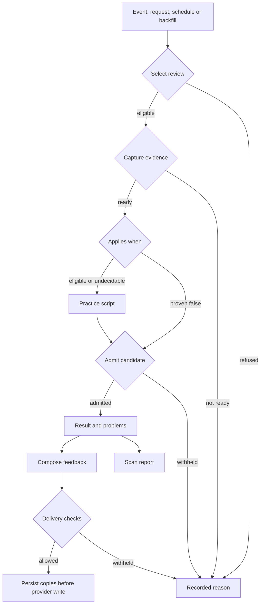

# Practice review pipeline

A review has four boundaries: selection, capture, result admission and delivery.
Each boundary can stop with its own reason.
A capture failure never becomes a claim about the work.
Withheld feedback is never reported as missing evidence.

## Select a review

Adapters record item events after source sync establishes the recorded change.
Repeated provider delivery does not create another event for the same item, name and version.
Queue updates retain the original event time, version and discovery source.
They change only decision and retry facts.

`reviewOn` selects events and recorded state for automatic review.
`appliesWhen` applies to every origin.

After capture readiness passes, the server checks the pinned practice version's conditions before sandbox execution.
The capture adapter interprets its evidence files and returns a decision for each clause through `CapturedApplicability`.
Capture requests use each collection's owning source from `EvidenceCollection`.
For example, `scm.inline-review-comments` reads the complete `scm.pull-request.comments` capture.
SCM changed-path conditions use Spring Ant path patterns with `/` as the separator.

If every alternative is proven false, admission records Does not apply with the authored `otherwise` reason.
Only complete captured sources can prove absence.
An undecidable alternative keeps the practice eligible.
A required capture failure retains its capture refusal and produces no result.
A request can bypass event selection, but cannot bypass scope, consent or evidence readiness.

Feedback mode Off does not refuse an otherwise eligible review.
Reviewed by People or Nobody prevents automated execution.

An ITEM review pins one item.
A provider pull request review is its own item, with its pull request as parent.
The practice's role must resolve to exactly one eligible human account.
No holder records ROLE_UNAVAILABLE. Multiple distinct holders record ROLE_AMBIGUOUS.
The server never picks the first assignee or makes an unresolved person anonymous.

Explicit `about=null` permits a developerless result.
All scan assignments are developerless.
Backfills record evidence without delivering feedback.
The [review glossary](./practice-review-glossary.mdx#origins) owns origin names.

### Source change and repair

GitHub and GitLab adapters preserve provider-specific snapshot coalescing and deletion behavior.
An issue edit can end current proof without erasing history.
A tombstone holds new review work. Disconnect erases the connected source through its eraser.
Restoration and a later eligible event can permit a fresh review.

A repair must capture the version it claims to review.
It cannot reconstruct a missed merge from the current head alone.
Duplicate event delivery does not extend a decision deadline or renew consent.
Provider comments identified as Hephaestus's own writes do not start a feedback loop.

The [sync lifecycle](./sync-lifecycle.md) owns adapter lifecycle details.
The [operations guide](/admin/practice-review-operations) owns queue timing and deployment controls.

## Capture evidence

The domain source supplies the pinned record, version, roles and authorized material.
Capture records availability, content, completeness and collection outcome separately.
Every required source must meet the practice's declared read requirements.
A missing, failed, redacted or incomplete required source records a readiness refusal.
It produces no result for that practice.
Other practices can run when their required sources are available.

For GitHub and GitLab reviews, a Git transport failure records `UNAVAILABLE` with `REPOSITORY_FETCH_FAILED` for the repository tree.
An unreadable pinned base or head records `REVIEW_VERSION_UNAVAILABLE`.

The pinned diff, file citations and commit records currently require the same Git objects.
They have no provider API fallback.
A fetch failure therefore also makes the diff unavailable and omits commit records.
Description and discussion capture can still succeed from synchronized provider records.
Readiness withholds practices that require the unavailable source and retains the precise reason in each source check.
Neither a fetch failure nor an unavailable source is evidence of a problem in the work.

Preparation failures log exception class names and their cause chain once per attempt.
These diagnostics exclude exception messages, credentials and provider bodies.

Consent checks apply to every person whose work the review reads.
The result's developer is not the only source-person dependency.
A missing required AI choice is a policy refusal, not an evidence gap.

The [source contract](./item-source-contract.mdx#capture-state) owns capture states.
The [workspace ABI](./agent/workspace-abi.mdx) owns the staged files.
Captured text is evidence, not instructions that can override the review contract.

## Admit results

Every practice uses the same script contract.
A null custom script invokes the built-in script.
An invalid custom script stops its practice without fallback.
Only the final candidate returned by the script reaches admission.

The host supplies assignment identity and trusted read receipts.
ITEM coverage includes relevant sources supplied or omitted by the opening brief.
A brief-only decision can be complete when all relevant records were supplied.
An omitted record requires continuous reads from line 1 through EOF.

The same range accounting governs ITEM file reads and SCAN reads.
Shell access has unknown coverage because it supplies no governed receipt.
No observed read failure does not establish complete coverage.

The server verifies shape, outcome requirements, quotations, source permission and claim basis.
One invalid problem, example or citation withholds the complete candidate.
Other valid practice candidates can continue.

A submission can contain candidates for a subset of its frozen assignments.
Every remaining runtime assignment supplies an explicit [runtime non-result](./practice-review-glossary.mdx#runtime-terms) reason.
Admission retains these reasons separately from results and candidate refusals.
When execution ends, settlement records these assignments without an outcome and closes the review as Partial.
A malformed owner or unauthorized submission refuses the submission.

Generic quotation checks belong to core and use the captured-text manifest.
Verifiers never supply the text that establishes a quote.
Quotation checks first use the supplied canonical file or record coordinates.
Repeated text at those coordinates is valid.
Only a unique quote can repair incorrect coordinates.

Domain checks verify side, version and change-basis references through the citation-verifier port.
An introduced code claim needs a head witness that intersects added lines in the pinned change.
A worsened code claim needs witnesses from the pinned base and head revisions, with added head evidence that supports the change mechanism.
The base witness shows the prior state and need not intersect removed lines.
These checks bound the witnesses. They do not prove the claimed consequence.

A missing domain verifier cannot authorize a version-dependent claim.
This keeps provider and diff meaning outside core admission.

The [product outcome contract](./practice-feedback-language.md#result-outcomes) owns outcome meanings.
The [script runner](./practice-script-runner.mdx) owns strict candidate fields and limits.
The [data model](./practice-feedback-schema.md) owns current-result identity and ordering.

## Compose feedback

Composition reads admitted, eligible results and their problems.
It never sends an open question or an example alone.
Feedback on the work speaks about Not met results for the eligible developer.
With no eligible problem, the review posts no praise comment.

Composer prompts set short text targets for each destination.
The tools refuse text above twice those targets and return an example for correction.
The composer keeps evidence and its qualifications when it shortens feedback.
Delivered prose uses natural evidence references without internal labels or coordinates.
Support references and anchors retain the exact evidence links.

Historical advice claims require confirmed shown words with authorized source custody.
Unavailable history is a failed or refused read, not an empty history.
Delivery facts can remain visible without copying unavailable words.
Earlier advice cannot be inferred from a provider comment's current contents.

Private cards and conversation feedback have their own permission and model gates.
No conversation brief is prepared unless an available Mentor model respects the developer's AI choice.
The host prepares the final public package before a private session starts.
A private setup failure or deadline does not erase that prepared review.
The destinations remain independently eligible.

The composer selects an inline citation by problem ID and citation index.
Preparation resolves that exact admitted citation.
A valid citation is not automatically commentable.
Placement requires the pinned revision, side, file path and complete range within one diff hunk.
The range must intersect changed lines.

GitHub creates a review comment.
GitLab creates a positioned diff discussion with the pinned base, start and head commit references.
Only a confirmed position rejection permits a file note with a static link to the reviewed code.
An uncertain write retains its attempted receipt and cannot start the fallback.
The receipt records the physical copy kind.
Slack and Outline do not receive SCM line notes.

Each copy retains the results and problems it communicates.
Preparation checks response suppression against that support, not every problem of each supporting result.
The review receipt retains every quiet decision and its prior-advice witnesses, including reviews that also raise feedback.
A practice-page card addresses one practice and retains its title, body and next step until the canonical renderer runs.
Conversation support requires eligible Not met results for every practice it names.

For conversation SUPERSEDE, the host resolves the prepared thread key to the queued feedback ID.
Preparation rechecks its developer, practice, destination, state and write fence.
The existing supersession service replaces the old queued feedback only after the new feedback is ready.
Public and private pieces use separate preparation requests.
A refusal for one package does not clear another package's accepted feedback.

## Deliver copies

Preparation commits feedback, basis, copies and an eligible send before external access.
Approval names the exact words, anchors and developer.
Approve or reject is permitted only before a copy write begins or a send is claimed.
A changed workspace policy cannot approve an older proposal implicitly.

A write fence is not proof of visibility.
Unknown visibility keeps feedback Unconfirmed and forbids automatic repeat writes.
Readback records found copies and proved absence without guessing.
An admin can retry a proved absent copy after all current gates pass.
Confirmed historical copies are never posted again.

Current source version, scope, consent, feedback mode, delivery pause and approval are checked at egress.
A work-state refusal does not erase the result.
Practice-page and conversation feedback retain their own visibility checks.

The [feedback model](./practice-feedback-schema.md#feedback-and-delivery) owns durable receipts.
The [operator guide](/admin/practice-review) owns approval, retry and diagnosis procedures.

## Correct results and feedback

An incorrect mark prevents its result from supporting new feedback.
The send service reconciles any started copy before it requests supported provider correction.
Unsupported correction leaves the actual posted appearance visible with its recorded reason.
Removing the mark rechecks current policy before restoring eligible unreplaced feedback.
It never reposts an earlier confirmed copy.

An accepted mark removes a result from open-problem lists without changing its outcome.
Neither mark ends the current result or restores older proof.
Withdrawal changes a private card's visibility, not its results.
Restore is the reverse action.
A developer's disagreement does not mark a result automatically.

## Scans

A scan pins the monitored default branch and complete inventory before practice filters.
Each selected practice/file pair has durable membership before execution.
The driver runs bounded file jobs serially.
It freezes the full model-slot method and practice version for reuse.

A complete assigned-file read is required for a Met scan result.
A listing, quotation or search alone cannot prove a complete file read.
Runtime failure records Withheld membership. Untouched listed work becomes Not reviewed after closure.
A partial scan never proves that its unreached work met a practice.

The removal guard uses the full repository inventory, not a practice selector.
Incomplete listing removes nothing.
A complete listing that would remove 20 percent or more of the earlier files is suspect and removes nothing.
Removing a file does not establish repair or absence of its problems.

Comparison requires equal standard, selectors and frozen method, plus complete new proof at a changed version.
Marks, reuse, withholding and missing reads do not prove absence.
Completed files in a partial scan can support comparison. The unreached remainder cannot.

The [scan guide](/admin/practice-scans) owns user procedures, report counts and export availability.
