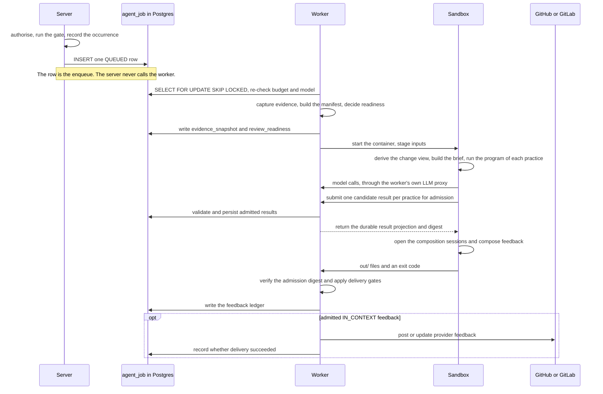

# Practice review runtime

Use this page to change where practice-review work executes or to extend an artifact handler.
For the review lifecycle and its product semantics, start with the [practice review pipeline](./practice-review-pipeline.mdx).

## Execution sequence

- **The `agent_job` table is the queue.** There is no broker between server and worker. Submission is one
  row containing metadata and an idempotency key. NATS carries webhook ingress upstream and is not part of
  the review queue.
- **Evidence capture runs on the claiming worker.** `ReviewRepositoryPreparer` authorizes the repository
  and clones or refreshes the worker-local mirror before pinning the review range. A missing mirror alone
  does not make the source unavailable. Disabled checkout records the tree as not collected. Preparation
  failures are recorded in the capture result.
- **The review range uses the range retained at admission when available.** The
  [pipeline guide](./practice-review-pipeline.mdx#capture) owns the rules for a retained range, a job
  without one, and GitHub.
- **`evidence_snapshot` and `review_readiness` are written before the container starts**, in their own transaction.
  A failed write fails the run before any model cost accrues. The result is a separate,
  later transaction.
- **One program per practice, inside the sandbox.** `pi-runner.ts` hosts the program of each admitted practice, one practice group per turn.
  The program is the practice's script, or the built-in program that asks for one review.
  Each review that a program asks for opens a fresh session, which ends once it submits the practice's result.
  The session gets the task, the brief, the criteria, the result illustrations, and the program's review input.
  The brief comes from the captured record and the derived change view. When the context fills and is compacted, the next turn carries them again.
  It also carries the result recorded so far.
  The [practice script runner](./practice-script-runner.mdx) owns how the host runs the programs.
  Thus, the model quotes the captured text, not a summary. The brief numbers the lines of captured
  files only. The derived change files are shown as written and marked not citable.
  `files.json` gives each file's lines in `diff.patch`.
  Thus, a large diff can be read a file at a time.
  [Practice review tools](./agent/workspace-abi.mdx#practice-review-tools) owns the recording contracts.
  The session is Pi's coding-agent `AgentSession`. Pi 1.0 also ships the experimental harness `pi-durable`.
  It checkpoints every model call and tool call so a crashed run can resume. It is not used.
  A review runs once in a sandbox that is discarded with its storage.
  The server retries a failed run from the captured evidence.
  `pi-durable` has no codemode.

- **Work, not time, bounds a turn.** [Work budgets](/admin/practice-review-operations#work-budgets) owns the shared pool and its calculation.
  The turn text does not state the budget.
  A turn gets one request to record when two calls remain.
  The request also occurs if the remaining tokens only pay for the results still owed.
  This uses the session's observed tokens per result. It ends at the first turn boundary after the call that spends the budget.
  Thus, that call's tools have run, including a recording. An aborted call records nothing. The budget caps a turn that runs away.
  It is several times normal turn spend, not a pace. Composition gets one unit per NOT_MET
  practice, at most a full turn's worth. Time is used for liveness only.
  A turn with no session event for five minutes is aborted as stalled.
  Two stalls in a row end measuring.
  The binding's timeout is a safety ceiling.
  Its split stops measuring early enough for admission and composition to complete. An aborted turn
  must become idle before another turn starts. Practices still missing get a finishing turn with their
  criteria and their own budget. They are not treated as completed reviews. See
  [recorded-result coverage](./practice-review-pipeline.mdx#recorded-result-coverage).
- **Composition follows durable admission.** [Measurement and intervention](./practice-review-pipeline.mdx#measurement-and-intervention) owns the separate practice, public composition, and private composition sessions.
- **The worker posts public feedback.** It validates sandbox output, persists results with their observations and feedback,
  and applies delivery policy before calling the provider. Model composition runs in the sandbox.
- **Control never returns to the server between claim and completion.** The only server-to-worker push is
  the hub WebSocket, and it carries cancellation and drain, not work.

## Extension points

Artifact handlers assemble context and delivery constraints.
Provider adapters own provider identifiers, diff and comment APIs, and conversation storage.
The practices module owns definitions, results, observations, and the feedback ledger.

The extension boundaries are:

- **Occasion gate** — decides whether an occurrence may enqueue work.
- **Queue and execution** — `agent_job`, described by
  [ADR 0025](https://github.com/hephaestus-build/Hephaestus/blob/main/docs/decisions/0025-agent-job-queue-on-postgresql.md).
- **Workspace ABI** — the sandbox receives read-only `inputs/`, disposable `work/`, and returns only
  `out/`. [Agent workspace ABI](agent/workspace-abi.mdx) is the source of truth for paths and exit codes.
- **Results** — each practice program returns one candidate result, and a review session submits through `submit_result`.
  Server admission validates the results in one call. Persistence stores each result with its observations, and gives each observation an evidence-location grouping key.
- **Feedback** — [measurement and intervention](./practice-review-pipeline.mdx#measurement-and-intervention) owns the public and private composition sessions and their recording tools.
  The runner refuses a practice-page card unless the practice is NOT_MET on at least `minDistinctArtifacts` distinct pieces of work.
  This threshold comes from the composition request.
  The count includes this work and the staged history.
  Thus, one occurrence stays a note on the work.
  Server admission validates the result without invalidating completed measurement. Admitted feedback,
  server suppressions, replacements, and placements enter the ledger. A model `WITHHOLD` remains only in
  the bounded job output. The seam itself is
  [ADR 0029](https://github.com/hephaestus-build/Hephaestus/blob/main/docs/decisions/0029-measurement-intervention-seam-and-channel-levels.md).

When changing sandbox inputs or outputs: update the owning runtime type or parser first.
Update the ABI page only for a durable ABI change.
Add a behavioral test at the narrowest owning boundary.
Regenerate OpenAPI and the web client when the HTTP contract changes.

To extend the bundled catalogue, follow [Practice catalogue curation](practice-catalogue.md).

Avoid copying file trees, enum inventories, defaults, or database columns into this guide.
Those details are owned by executable types, Liquibase, the generated database schema, and OpenAPI.
